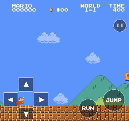

# Mario C# · Godot / OpenHarmony

使用 Godot .NET 与独立 C# 游戏逻辑实现的 Super Mario Bros. 研究工程，包含 1-1 至 8-4 的 32 个主关及地下、云端、传送区和城堡分段等共 57 个房间。

[未签名 HAP 下载](https://github.com/kdada/mario-csharp/releases) · [素材来源](SOURCES.md) · [验证范围](VERIFICATION.md)

## 操作

| 操作 | 键盘 | 手柄 |
| --- | --- | --- |
| 移动 | A/D、方向键 | 左摇杆、方向键 |
| 跳跃、游泳 | J | A |
| 冲刺、火球 | K | X；右肩键也可冲刺 |
| 蹲下、进管道 | S、↓ | ↓ |
| 爬藤蔓 | W、↑ | ↑ |
| 确认、暂停 | Enter | Start |
| 返回 | Esc、菜单中的 K | B |
| 静音 | M | — |

支持向左回走、双向跟随相机、32 关选关、本地进度及最高分。K＋长按 J 的跳高约 65 像素；TIME 每秒减少 1.5 单位；蘑菇和花变身时暂停场景 0.72 秒。最新版本修正了金币 1.5 格/半格弹跳、进出管道食人花隐藏和旗杆底座遮挡。

## 手机虚拟按钮

启动时通过鸿蒙公共 NDK `OH_GetDeviceType()` 读取真实设备类型：手机 `phone` 自动显示虚拟按钮；触屏电脑 `2in1`、平板及未知设备均默认隐藏。不会用“支持触摸屏”冒充手机检测。

- 左侧四向方向键用于移动、蹲下、进管道和爬藤蔓。
- 右侧 RUN 负责冲刺/火球，JUMP 负责跳跃/游泳；右拇指从 RUN 滑到 JUMP 可保持冲刺，同时用左拇指控制方向。
- 支持多指同时按住、按下反馈、快速轻点和滑动换键；抬手、触摸取消、切后台、失焦或视口改变时释放。
- 游戏中的 II 暂停/恢复；菜单中使用方向键、OK 和 BACK，文字与选关列表为虚拟按钮留出空间。
- 电脑可按 T 手动预览，默认继续使用键盘/手柄。

原生 Editor 中的手机控件预览：



## 在 Editor 运行

使用带 C# 的 OpenHarmony Godot 4.7.2 编辑器及配套 .NET SDK 10.0.401。工程使用 `Godot.NET.Sdk/4.7.2-ohos.3`、`net10.0`；配套 Godot NuGet 包保存在 `ThirdParty/GodotNuGet`，包源不依赖作者的个人目录。

```sh
dotnet restore --configfile NuGet.Config
dotnet build --no-restore
```

导入 `project.godot`，按 F5，选择 NEW GAME 或 LEVEL SELECT。普通非 .NET 编辑器不能运行本工程。

## 导出未签名 HAP

本机导出工具链为 Godot `4.7.2-ohos.7`、.NET SDK `10.0.401-ohos.2`、官方 Command Line Tools `26.0.0.201`。使用相互匹配的 CLI 与 ARM64 Release 模板。HAP 使用 NativeAOT，不需要设备另外安装 .NET SDK。

```sh
python3 Tools/export_hap.py --output dist/mario-csharp-0.1.1-arm64-unsigned.hap
```

默认从 `~/.oheco/packages` 定位工具；其他安装位置可显式传入 `--godot-devkit`、`--dotnet-sdk`、`--command-line-tools`。脚本在独立缓存副本中构建，不修改工作工程；临时文件使用 `$TMPDIR`。本机构建器需已准备好官方 Hvigor wrapper 缓存。

导出预设关闭 HAP 签名，包名 `org.kdada.mariocsharp`，兼容 API 26。安装前需要自行签名。直接读取的 PNG、JSON、音频与 CHR 由构建专用导出插件按原字节打包；游戏运行时代码仍全部为 C#。导出副本不包含 DSH 调试助手。

本次按要求不对 HAP 做包审计、安装或运行测试。Editor 环境的回归记录与 HAP 安装验收是不同范围。

## 源码与素材

- `Scripts/`：独立 C# 游戏逻辑、JSON 预生成序列化上下文及回归程序。
- `Scenes/Game.tscn`：主场景。
- `Data/`：声明式关卡、碰撞和实体数据。
- `Assets/`：原始图像、CHR、精灵描述、配色与音频。
- `Tools/`：布局转换、Editor 回归和未签名 HAP 导出工具。

游戏不引用参考项目的运行时代码，也不运行下载的 GDScript 游戏控制器。图像、关卡设计、音乐和商标仍归原权利人；来源与处理方式见 `SOURCES.md`，第三方许可文本见 `Licenses/`。Godot SDK 包保留其 MIT 许可，不将程序许可证解释为 Nintendo 素材授权。

## 完成度

主线关卡和房间已实现，并有场景及机制回归；尚未完成从 New Game 到 8-4 结局的连续输入通关，也未逐帧对照 NES。当前为单人流程，尚未实现双人轮流模式、通关后第二轮敌人替换及原硬件全部边缘行为。
